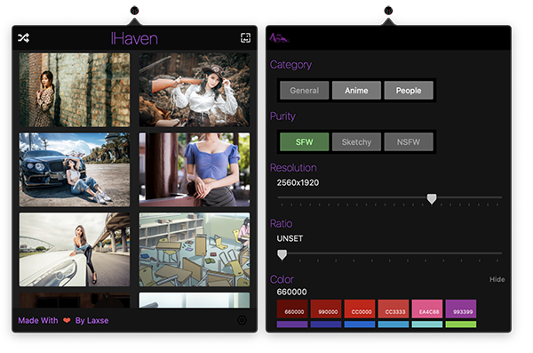
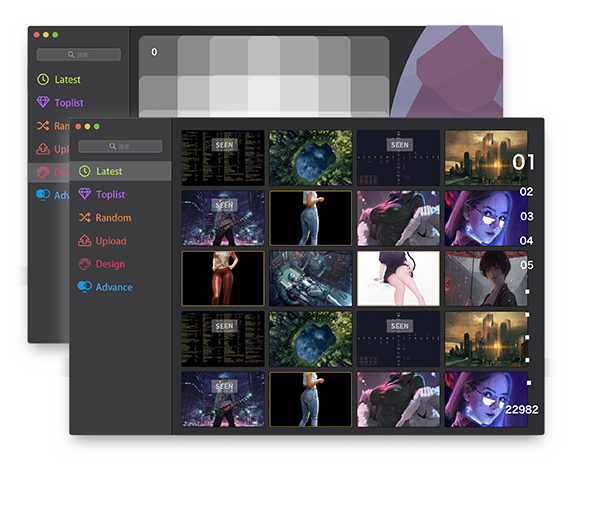

<h1 align="center" style="font-size:36px" >IHaven</h1>
<h4 align="center" style="font-size:18px" >🍭Awesome Wallpaper App Based on SwiftUI Power By Wallhaven aimed to macOS</h4>

 

        
        
        
        
        

Visit website <a href="http://ihaven.laxse.cn">IHaven</a> or （release to）download. f^_^;

# 本地开发（免 VPN Mock）
`wallhaven.cc` 在部分网络下需启用 VPN 才能访问，开发环境不便长期开 VPN。本项目内置了**进程内 Mock 服务**，开启后直接返回合成数据，无需任何网络即可开发调试。

启用方式（Xcode）：
1. 打开项目，`Edit Scheme → Run → Arguments → Environment Variables`
2. 添加 `IHAVEN_MOCK = 1`
3. `⌘R` 运行。瀑布流会直接加载合成壁纸（竖图 / 方图 / 横图 / 宽屏 / 超宽 五种比例循环，渐变占位图），翻页、收藏、设为壁纸均可正常走通。

关闭：删除该环境变量即切回真实 `wallhaven.cc` 服务。**真实环境零影响**——仅当 `IHAVEN_MOCK=1` 时才接管请求。

实现说明：拦截逻辑在 `Sources/IHavenApp/Infrastructure/Network/MockWallhaven.swift`，由 `IHavenApp.bootstrap()` 在启动最开头调用 `MockWallhaven.configureIfNeeded()` 注册 `URLProtocol`，拦截对 `mock.wallhaven.local` 的请求——`/api/v1/search` 返回合成 `WallhavenPage` JSON，`/thumb` 与 `/wallpaper` 路径返回进程内（CoreGraphics + ImageIO）生成的渐变 JPEG。整条链路（请求 → JSON 解码 → Nuke 预取 → 缩略图渲染 → 设为壁纸原图下载）零网络。

# Features  
* Api from wallhacen.cc
* Customized query conditions
* Popover-style And Infinite-scroll
* Quick / Free Download
* More features comming soon ...
# Screenshots
 - v1

 - v2

# Future
* Image Description View
* Window Style Application
* Localization
* Dynastic Wallpaper Designer
* Image Toolkit

# Localization
Ihaven will auto detect your system language and use the localization.

You can set language manually in the Settings window.

Now the app support $\color{red}{nothing}$ 😰

# License
IHaven itself is licensed under the  MIT License  license.
