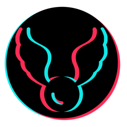
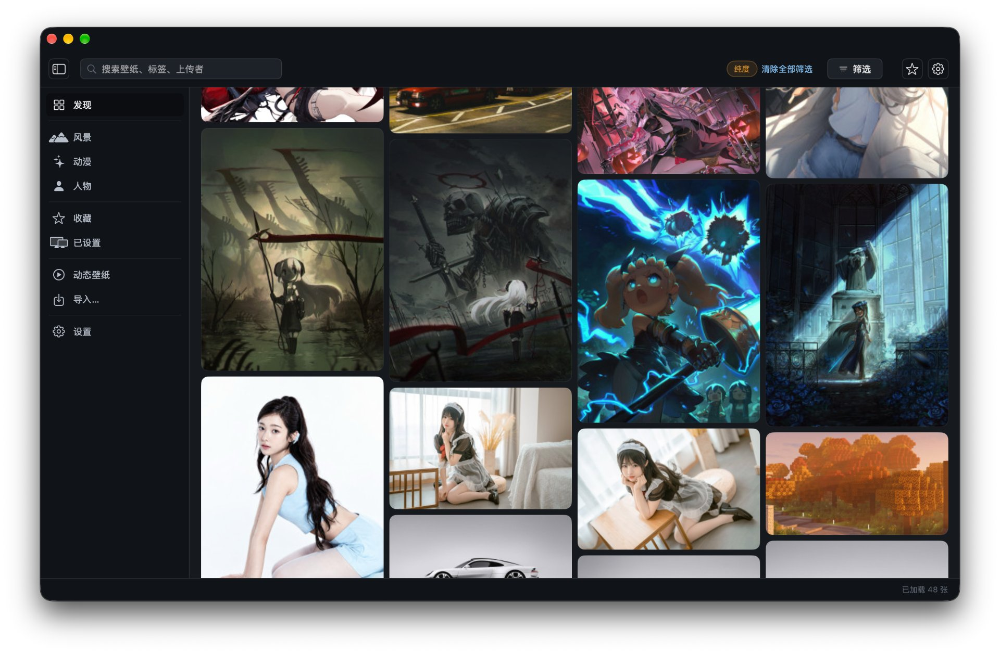
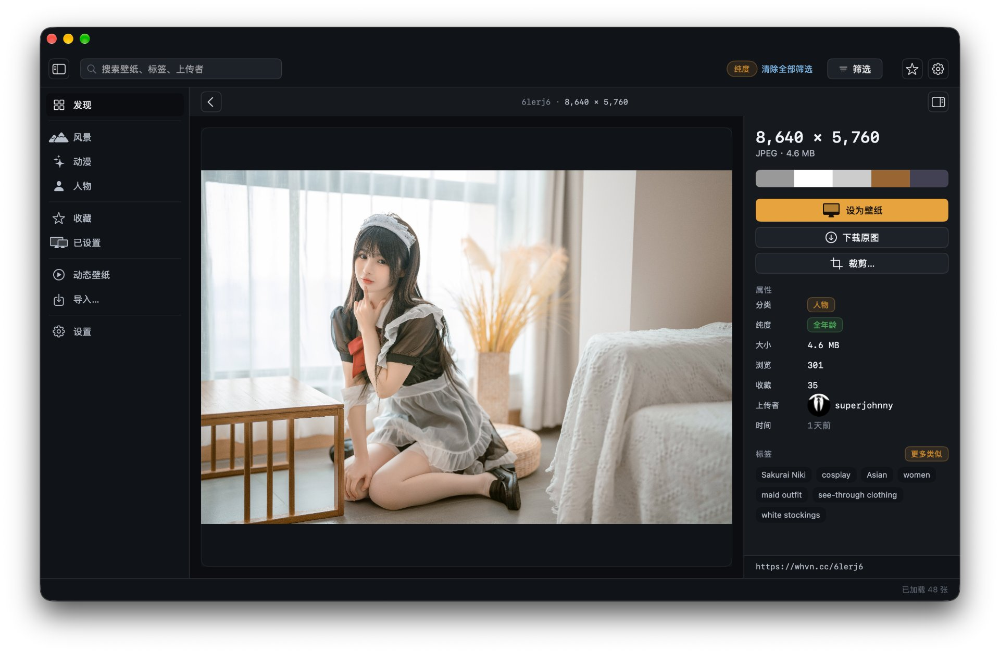
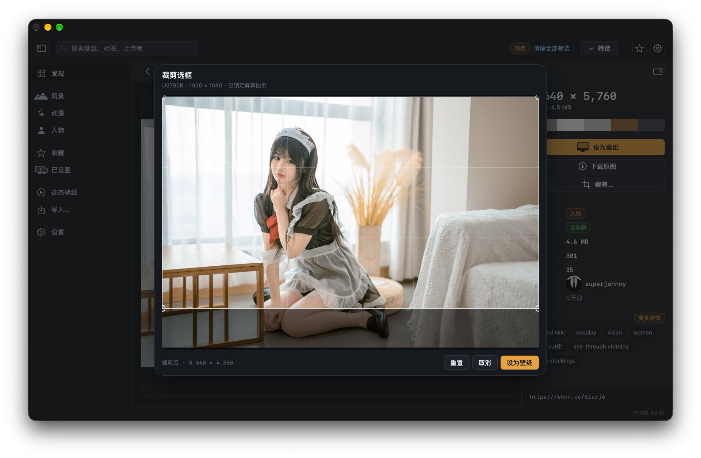

<div align="center">
  

  <h1>IHaven</h1>

  <p><strong>A native macOS wallpaper browser and manager, powered by wallhaven.cc.</strong></p>

  <p>
    
    
    
    
    
    <a href="https://github.com/Laxse/IHaven/actions/workflows/gates.yml">
      
    </a>
  </p>
</div>

---

IHaven is a macOS app for finding, managing and applying wallpapers from
[wallhaven.cc](https://wallhaven.cc). It is a native SwiftUI application — not an Electron shell and
not a web wrapper — built for macOS 26 and later, with the kind of behaviour you would expect from a
first-party system utility: a masonry browse grid, a full metadata detail page, per-screen
assignment, locally generated dynamic wallpapers, and a menu bar panel for the things you do ten
times a day.

<div align="center">
  
  <br>
  <sub>The main window — masonry grid, mixed aspect ratios, infinite scroll</sub>
</div>

## Contents

- [Features](#features)
- [Screenshots](#screenshots)
- [Requirements](#requirements)
- [Installation](#installation)
- [Getting started](#getting-started)
- [Architecture](#architecture)
- [Project layout](#project-layout)
- [Development](#development)
- [Roadmap](#roadmap)
- [Non-goals](#non-goals)
- [Privacy](#privacy)
- [Contributing](#contributing)
- [License](#license)
- [Acknowledgements](#acknowledgements)

## Features

**Browse**

- Masonry waterfall grid with true infinite scroll and mixed aspect ratios
- Rich filters: resolution, aspect ratio, dominant colour, category, purity, sorting and time range
- Instant low-resolution preview that swaps to the full-resolution original, with a visible download
  progress bar so you can tell "still loading" apart from "this image is soft"
- Detail page: the complete image (never cropped), a metadata sidebar, download original, and
  set-as-wallpaper
- Disk-backed image cache (Nuke `DataCache`, 512 MB) — a wallpaper you have already seen is never
  downloaded twice. Settings ▸ Storage shows the usage and lets you clear it
- Offline fallback: if the network is unavailable, an already-cached original is reused instead of
  failing

**Set as wallpaper**

- **Crop before you set** — pick the part of a portrait image you actually want, locked to your
  screen's aspect ratio, so vertical wallpapers never end up with black bars down the sides
- Per-screen assignment, plus a fill colour derived from the wallpaper's own palette
- Favorites library and an "already applied" history, both stored locally in SQLite
- Albums: group any wallpaper into themed local albums — a second organizing layer on top of
  favorites, where one wallpaper can live in several albums at once
- Timeline: your applied history regrouped by day, so you can see what you had when and re-apply it

**Dynamic wallpapers**

- Turn any static image into a locally rendered dynamic wallpaper (breathe / pan / push-in, seamless
  loop). No video file is involved — frames are rendered on your Mac as a JPEG sequence
- Performance guard: auto-pauses when the frontmost app is full screen, on low battery, or in Low
  Power Mode, with a visible CPU / memory readout

**Automation**

- Menu bar panel: search, shuffle, previous / next, one-click change, favorites — without opening
  the main window
- Rotation schedule: switch by time of day or weekday, per display, drawing from imported files,
  your applied history, favorites or an album
- Global hotkey ⌥⌘S: shuffle to a new wallpaper from anywhere, even when IHaven is in the
  background (grant it once under System Settings ▸ Privacy & Security ▸ Accessibility)
- Client-side rate limiting (45 req/min token bucket) with exponential backoff, so the app never
  trips wallhaven's limits on your behalf

**Your own images**

- Import your own pictures and manage them in a dedicated **Import…** tab. They are deliberately
  kept out of the wallhaven grid — local files carry no category, tag or search relevance there,
  so mixing them in would only clutter the results (see `docs/decisions/OPEN-DECISIONS.md`)

**Interface**

- Chinese (Simplified) and English, following your system language or a manual override in
  Settings ▸ Appearance

## Screenshots

<div align="center">
  
  <br>
  <sub>Detail page — the complete image (never cropped), metadata sidebar, and the three actions</sub>
</div>

<div align="center">
  
  <br>
  <sub>Crop before setting — a draggable box locked to your screen's aspect ratio</sub>
</div>

*Screenshots show the Chinese interface. Switch to English in **Settings ▸ Appearance**.*

## Requirements

| | |
|---|---|
| macOS | 26.0 or later |
| Architecture | Apple silicon or Intel |
| To build | Xcode 26 or later (Swift 6 toolchain) |
| Wallpaper source | A [wallhaven.cc](https://wallhaven.cc) account is optional, but an API key unlocks NSFW purity levels and your account's default filters |

## Installation

### Download

Grab the latest build from [GitHub Releases](https://github.com/Laxse/IHaven/releases) or from
[ihaven.laxse.cn](http://ihaven.laxse.cn), then drag `IHaven.app` into `/Applications`.

Release builds are ad-hoc signed, not notarized. On first launch macOS will refuse to open it
normally — **right-click the app and choose Open**, then confirm once. Subsequent launches are
normal. This is expected for a self-built, unsigned app and has nothing to do with the app itself.

### Build from source

```bash
git clone https://github.com/Laxse/IHaven.git
cd IHaven

# `--disable-sandbox` is required: SwiftPM's default sandbox aborts this build
# (sandbox_apply: Operation not permitted) on the current toolchain.
swift build --disable-sandbox

# Produce a signed, bundled .app at dist/IHaven.app
bash scripts/build-and-package.sh
open dist/IHaven.app
```

`build-and-package.sh` does four things: builds in release configuration, assembles the bundle
(including the SwiftPM resource bundle with both `.lproj` folders), builds `AppIcon.icns` from the
master PNG, and applies an ad-hoc codesign. It also fails the build if the app version in
`AppInfo.swift` and `Packaging/Info.plist` disagree, or if the two `Localizable.strings` files have
different key counts — both are drift that used to ship silently.

## Getting started

1. Launch IHaven. Browse works immediately with no configuration.
2. (Optional) Copy your API key from [wallhaven.cc/settings/account](https://wallhaven.cc/settings/account)
   and paste it into **Settings ▸ API Key**. This unlocks NSFW purity levels and syncs the default
   filters from your wallhaven account.
3. Pick a wallpaper, open its detail page, and choose **Set as Wallpaper**. If the image is portrait
   and your screen is landscape, use **Crop…** first to choose which part becomes the wallpaper.

## Architecture

IHaven is strictly layered. Dependencies only ever point downwards, and the Feature layer sees Core
protocols — never a concrete network, database or AppKit type:

```
Core/            models + protocols          (no dependencies on any other layer)
  ↓
Infrastructure/  network, database, image    (implements Core protocols)
  ↓
Platform/        AppKit / system integration (implements Core protocols)
  ↓
Features/        SwiftUI views + view models (sees Core protocols only)
  ↓
App/             IHavenApp.swift — the single assembly point
```

`App/IHavenApp.swift` is the only place where concrete implementations are chosen and injected.
Nothing else in the app constructs a `Platform` type, which is what keeps the layering from rotting.

Notable decisions are recorded as Architecture Decision Records in
[`docs/decisions/`](docs/decisions) — 18 of them so far, covering image loading (Nuke), storage
(GRDB), state management (`@Observable` only, no `ObservableObject`), API key handling, dynamic
wallpapers, caching and the crop pipeline. Start with
[`docs/ARCHITECTURE.md`](docs/ARCHITECTURE.md); [`OPEN-DECISIONS.md`](docs/decisions/OPEN-DECISIONS.md)
lists what is still unresolved.

## Project layout

```
Sources/IHavenApp/
├── Core/            models, protocols, design tokens
├── Infrastructure/  Wallhaven client, GRDB database, Nuke pipeline, image download
├── Platform/        system wallpaper engine, desktop windows, power/thermal monitors
├── Features/        Browse · Detail · Import · DynamicWallpaper · Settings · MenuBar · Shared
├── Resources/       zh-Hans.lproj, en.lproj
└── App/             IHavenApp.swift

docs/                PRD, SPEC, DESIGN, ARCHITECTURE, verified-API notes, ADRs
scripts/             quality gates and the packaging script
Packaging/           Info.plist
```

Roughly 11,300 lines of Swift across 113 files, with a hard rule that **no single file may exceed
300 lines** (and the app entry point 120). `scripts/convention-gate.sh` enforces it.

## Development

### Mock mode (no network, no VPN)

`wallhaven.cc` is unreachable without a VPN on some networks, which makes day-to-day development
painful. IHaven ships an in-process mock that returns synthetic data with zero network access:

```bash
IHAVEN_MOCK=1 .build/debug/IHavenApp
```

In Xcode: **Edit Scheme ▸ Run ▸ Arguments ▸ Environment Variables**, add `IHAVEN_MOCK` = `1`.

You get synthetic wallpapers cycling through portrait / square / landscape / widescreen / ultrawide,
with gradient placeholder images. Paging, favouriting and set-as-wallpaper all work end to end. The
real service is untouched — the mock only takes over when the variable is set.

The interception lives in `Sources/IHavenApp/Infrastructure/Network/MockWallhaven.swift`, which
registers a `URLProtocol` at startup and answers `/api/v1/search`, `/thumb` and `/wallpaper` with
CoreGraphics-generated JPEGs.

### Quality gates

Four automated gates run in CI on every push and pull request, and should be run locally before
committing:

| Gate | What it checks |
|---|---|
| `scripts/convention-gate.sh` | File length limits, no `ObservableObject` family, no reverse layer dependencies, whitelisted wallhaven query parameters |
| `scripts/security-gate.sh` | No hardcoded or logged API keys, no private API loading |
| `scripts/api-gate.sh` | Type-checks `docs/VERIFIED-API.swift` against the real macOS SDK — every Apple API we call is proven to exist with the signature we assume |
| `scripts/verify-docs.py` | Doc hygiene, ADR cross-reference integrity, and section regression against `HEAD` |

Run them all with:

```bash
bash scripts/convention-gate.sh && bash scripts/security-gate.sh \
  && bash scripts/api-gate.sh && python3 scripts/verify-docs.py
```

There is also an optional pre-commit hook (`docs/pre-commit.sh`) that checks Chinese punctuation
spacing. Install it with:

```bash
cp docs/pre-commit.sh .git/hooks/pre-commit && chmod +x .git/hooks/pre-commit
```

## Roadmap

Planned, in rough priority order:

- AI-assisted dynamic wallpaper generation, gated behind an optional key in Settings
- Broader real-device verification on multi-screen setups
- More localizations beyond Chinese (Simplified) and English

## Non-goals

Some things are deliberately **not** planned, usually because the platform does not allow them or
because a half-working version is worse than none:

- **Screen saver support** — re-examined and rejected; macOS gives third-party apps no supported way
  to install one
- **Video wallpapers (MP4 / MOV / WEBM)** — dynamic wallpapers are generated locally from a static
  image instead (see ADR-016)
- **FFmpeg or any private Apple API** — no bundled binary blob, no `WallpaperExtensionKit` (ADR-008)
- **Free-form crop aspect ratios** — the crop box is deliberately locked to your screen's ratio, so a
  cropped wallpaper never ends up with black bars. A free ratio cannot guarantee that (see ADR-018);
  this is a designed limitation, not a missing feature

## Privacy

- Your API key is stored in a local dotfile in your home directory. It is never written to
  `UserDefaults`, never logged, and never sent anywhere except to wallhaven.cc as an `X-API-Key`
  request header (ADR-006, ADR-010).
- Favorites, applied history, imported images and cached images all live under
  `~/Library/Application Support/IHaven/`. Nothing is uploaded.
- No analytics, no crash reporting, no telemetry.

## Contributing

Issues and pull requests are welcome. Before opening a PR:

1. Run all four gates (see [Quality gates](#quality-gates)).
2. Keep every file under 300 lines. Split into an extension file rather than exceeding it.
3. Add both `zh-Hans` and `en` entries for any new user-facing string. Chinese is the development
   language, so the Chinese string in the source *is* the localization key.
4. If your change involves a non-obvious Apple API, add it to `docs/VERIFIED-API.swift` so
   `api-gate.sh` proves the signature.
5. For an architectural change, add an ADR under `docs/decisions/` following the existing template.

## License

MIT — see [LICENSE](LICENSE).

IHaven is an unofficial client. It is not affiliated with or endorsed by wallhaven.cc; all wallpaper
content belongs to its respective uploaders, and you are responsible for complying with wallhaven's
terms and the licence of any image you download.

## Acknowledgements

- [wallhaven.cc](https://wallhaven.cc) for the wallpaper API
- [Nuke](https://github.com/kean/Nuke) for image loading and caching
- [GRDB.swift](https://github.com/groue/GRDB.swift) for SQLite
